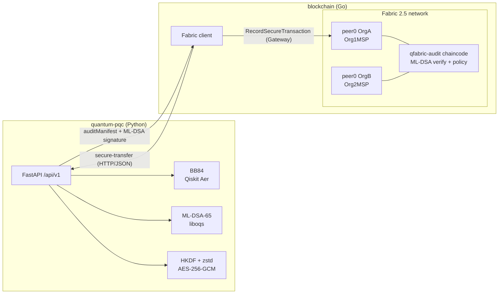

# QFabric

### Quantum-Assisted Post-Quantum Security for Hyperledger Fabric

QFabric is a hybrid security framework for permissioned blockchains. Organizations on a Hyperledger Fabric network authenticate with **ML-DSA-65** post-quantum signatures, establish encryption keys with **BB84** quantum key distribution (simulated with IBM Qiskit), protect documents with **AES-256-GCM**, and record **verifiable, tamper-evident security audit events** on the ledger.

Built for **Qiskit IBM Quantum Hacks, Challenge 5: Post-Quantum Cryptography**.

> **Project status: Phase 1 (repository initialization).** Architecture, integration contract, scaffolds and tooling are in place. Most protocol logic is still stubbed. See [Implementation status](#implementation-status). Nothing below is claimed to work unless that table says so.

---

## Contents

1. [Problem statement](#1-problem-statement)
2. [Why quantum computers threaten blockchain cryptography](#2-why-quantum-computers-threaten-blockchain-cryptography)
3. [Proposed solution](#3-proposed-solution)
4. [Architecture](#4-architecture)
5. [ML-DSA](#5-ml-dsa-post-quantum-signatures)
6. [BB84](#6-bb84-quantum-key-distribution)
7. [AES-256-GCM](#7-aes-256-gcm)
8. [Hyperledger Fabric integration](#8-hyperledger-fabric-integration)
9. [Directory structure](#9-directory-structure)
10. [Team responsibilities](#10-team-responsibilities)
11. [Installation requirements](#11-installation-requirements)
12. [Environment setup](#12-environment-setup)
13. [Running the Quantum/PQC module](#13-running-the-quantumpqc-module)
14. [Running the Fabric network](#14-running-the-fabric-network)
15. [Deploying the chaincode](#15-deploying-the-chaincode)
16. [Running the integrated demo](#16-running-the-integrated-demo)
17. [Benchmarking](#17-benchmarking)
18. [Security assumptions and limitations](#18-security-assumptions-and-limitations)
19. [References](#19-references)

---

## Implementation status

| Area | Status |
|---|---|
| Repository structure, docs, API contract, sample payloads | ✅ |
| ML-DSA-65 cross-language test vector (Go CIRCL ↔ Python liboqs 0.16.0) | ✅ verified both ways |
| Fabric 2.5.16 network, channel, chaincode deploy and upgrade | ✅ running |
| Chaincode: register/get org, record/get/list transactions, re-verify. ML-DSA-65 verification on both peers, policy, replay guard | ✅ unit-tested and deployed |
| Fabric client (gateway, CLI, crypto API client) | ✅ end to end on the live network |
| Live attack scenarios: replay, tampered manifest, wrong MSP | ✅ all refused |
| Crypto API skeleton, schemas, `/health`, error envelope, Docker image | ✅ |
| **BB84 (Qiskit), ML-DSA service logic, HKDF/AES-GCM/compression** | ⏳ **not implemented** (stubs in `quantum-pqc/`) |
| ML-KEM | ➖ not part of the current design (see [SECURITY_MODEL.md](docs/SECURITY_MODEL.md)) |
| End-to-end demo | 🟡 runs with the **mock** crypto service (`MOCK_CRYPTO=1`). Real BB84 pending |
| Benchmarks | ⏳ Phase 4 |

---

## 1. Problem statement

Hyperledger Fabric authenticates members, transactions and blocks with **ECDSA** and X.509 certificates, and protects links with classical TLS key exchange. A cryptographically relevant quantum computer would let an attacker forge organizational signatures and decrypt recorded key exchanges. Long-lived ledgers and confidential inter-organization documents are exactly the data worth harvesting now and decrypting later. Details: [docs/PROBLEM_STATEMENT.md](docs/PROBLEM_STATEMENT.md).

## 2. Why quantum computers threaten blockchain cryptography

| Primitive | Used by Fabric for | Quantum attack | Impact |
|---|---|---|---|
| ECDSA P-256 | Transaction, endorsement and block signatures, MSP identities | **Shor**: polynomial-time ECDLP | Private keys recoverable from public certificates, so identities become forgeable |
| ECDHE / RSA (TLS) | Peer and client channels | **Shor** | Recorded sessions decryptable later |
| SHA-256 | Block hashing | Grover (quadratic speedup) | Still adequate |
| AES-256 | Symmetric encryption | Grover reduces it to ~128-bit | Still adequate |

NIST standardized post-quantum replacements in 2024 (FIPS 203 ML-KEM, FIPS 204 ML-DSA, FIPS 205 SLH-DSA). Fabric has not adopted them yet.

## 3. Proposed solution

QFabric adds quantum-era protection **at the application layer**, without forking Fabric:

| Layer | Mechanism | Category |
|---|---|---|
| Authentication | **ML-DSA-65** signatures on BB84 transcripts and audit manifests. Public keys anchored on the ledger | Post-quantum cryptography |
| Key establishment | **BB84** on Qiskit Aer, with QBER-based eavesdropping detection | Quantum cryptography (QKD), **not** PQC |
| Key derivation | **HKDF-SHA-256** bound to session and direction | Symmetric |
| Confidentiality | **zstd** compression, then **AES-256-GCM** | Symmetric AEAD |
| Auditability | **Fabric chaincode** that re-verifies ML-DSA signatures and applies a security policy | Permissioned ledger |

The ledger does **not** trust the crypto service. It verifies the signed manifest itself and records `VERIFIED` or `REJECTED`.

## 4. Architecture



End-to-end flow:

1. Each org generates an ML-DSA-65 key pair. The public key is registered on the ledger, bound to the org's Fabric MSP.
2. OrgA → OrgB transfer: BB84 runs on Qiskit Aer. The classical reconciliation transcript is signed by both orgs.
3. If QBER ≤ 11%: error correction, privacy amplification, 256-bit secret, HKDF → AES key, compress + encrypt + decrypt check. Otherwise abort.
4. OrgA signs a canonical **audit manifest** (hashes, QBER, status). There is no plaintext and there are no keys in it.
5. The client submits the manifest + signature. Chaincode on **both** peers verifies the signature against the ledger key and records `VERIFIED` or `REJECTED`.

Sequence diagrams for authentication, BB84, document exchange and audit recording: [docs/ARCHITECTURE.md](docs/ARCHITECTURE.md).

## 5. ML-DSA (post-quantum signatures)

ML-DSA (Module-Lattice-Based Digital Signature Algorithm, **NIST FIPS 204**, derived from CRYSTALS-Dilithium) is a classical signature scheme whose security rests on lattice problems (Module-LWE/SIS) that no known quantum algorithm solves efficiently. QFabric uses **ML-DSA-65** (NIST security category 3):

| | ML-DSA-65 | ECDSA P-256 |
|---|---|---|
| Public key | 1952 B | 64–65 B |
| Signature | 3309 B | ~64–72 B |
| Quantum-safe | yes (by design) | no |

Uses in QFabric: organization identity, BB84 transcript authentication (which stops man-in-the-middle attacks on the classical channel), and audit-manifest signatures verified **on-chain** with Cloudflare CIRCL. The Python side uses liboqs. A shared test vector proves the two implementations interoperate (pure ML-DSA, empty context).

## 6. BB84 (quantum key distribution)

BB84 (Bennett & Brassard, 1984) lets two parties grow a shared secret whose secrecy follows from quantum mechanics: measuring a qubit in the wrong basis disturbs it.

1. Alice encodes random bits in random bases (Z: |0⟩/|1⟩, X: |+⟩/|−⟩) as **Qiskit circuits**.
2. Bob measures in random bases on **Qiskit Aer**.
3. **Sifting:** keep the positions where the bases matched (~50%).
4. **QBER estimation** on a disclosed sample. An intercept-resend Eve causes ~25% QBER. **Abort above 11%.**
5. **Error correction** (Cascade-style, leakage counted), **key confirmation**, **privacy amplification** (Toeplitz hashing), giving a 256-bit secret.

The classical channel must be authenticated, and QFabric uses ML-DSA for that. The quantum channel is **simulated**. See [limitations](#18-security-assumptions-and-limitations).

## 7. AES-256-GCM

The BB84 secret never encrypts data directly. **HKDF-SHA-256** derives a 256-bit AES key bound to the session ID and the sender→receiver direction. Documents are compressed (zstd/gzip) **before** encryption, since ciphertext doesn't compress. AES-256-GCM provides confidentiality and integrity. A random 96-bit nonce and associated data (session, sender, receiver) make any tampering or cross-session replay fail authentication. AES-256 retains ~128-bit security against Grover's algorithm.

## 8. Hyperledger Fabric integration

- **Network:** Fabric 2.5.16 test network. OrgA (Manufacturer) = Org1MSP, OrgB (Supplier) = Org2MSP, Raft orderer, Fabric CAs.
- **Chaincode `qfabric-audit` (Go):** `RegisterOrganization`, `GetOrganization`, `RecordSecureTransaction`, `GetTransaction`, `GetAllTransactions`, `VerifyTransactionRecord`.
- **Two authentication layers, kept distinct:**
  - *Fabric MSP (ECDSA):* who submitted or endorsed the Fabric transaction.
  - *ML-DSA-65 (application):* which org authored the audit manifest, verified by chaincode on every endorsing peer.
- **On-chain:** hashes, QBER, statuses, ML-DSA public keys and signatures. **Never** plaintext, private keys or BB84 secrets.
- **Rejections are audited:** an eavesdropped session is recorded as `REJECTED` with reasons. Forged, replayed or mis-attributed submissions are refused outright.

## 9. Directory structure

```text
qfabric/
├── README.md  CONTRIBUTING.md  LICENSE  .gitignore  .env.example  docker-compose.yml
├── docs/                 PROJECT_OVERVIEW, ARCHITECTURE, PROBLEM_STATEMENT, SECURITY_MODEL,
│                         API_CONTRACT, INTEGRATION_GUIDE, DEVELOPMENT_GUIDE, BENCHMARKING, REFERENCES
├── integration/          API_CONTRACT (quick ref + sign-off), sample_request/response.json,
│                         test_vectors/mldsa65_audit_manifest.json
├── quantum-pqc/          Dev 2: Python
│   ├── bb84/             alice, bob, quantum_channel, eavesdropper, basis_reconciliation,
│   │                     error_correction, privacy_amplification, protocol
│   ├── mldsa/            keygen, signing, verification, identity, manifest
│   ├── encryption/       key_derivation, compression, encryption, decryption
│   ├── api/              main, routes, schemas, services (FastAPI)
│   ├── scripts/          demo_bb84, demo_mldsa, demo_secure_transfer
│   ├── tests/            test_bb84, test_eavesdropping, test_mldsa, test_encryption, test_integration
│   └── Dockerfile  requirements.txt  pytest.ini  .env.example
├── blockchain/           Dev 1: Go
│   ├── go.mod            client + integration + tests module
│   ├── network/          fabric-samples test network (downloaded, git-ignored)
│   ├── chaincode/qfabric-audit/   main, audit, organization, transaction, audit_test (own go.mod)
│   ├── client/           main, gateway, transaction, config
│   ├── integration/      crypto_client, metadata
│   ├── scripts/          common, start-network, create-channel, deploy-chaincode, stop-network
│   └── tests/            integration_test.go
├── frontend/             deferred until the backend works
├── benchmarks/           plan in docs/BENCHMARKING.md
└── scripts/              setup.sh, run-demo.sh
```

Deviations from the original plan, with reasons: [docs/ARCHITECTURE.md §6](docs/ARCHITECTURE.md#6-deviations-from-the-initial-layout).

## 10. Team responsibilities

| | Developer 1: Blockchain | Developer 2: Quantum/PQC |
|---|---|---|
| Owns | `blockchain/`, root README, `docs/`, `integration/`, `scripts/` | `quantum-pqc/` |
| Builds | Fabric network, channel, Go chaincode, audit records, org registration, Fabric client, blockchain tests | BB84 (Alice, Bob, Eve, sifting, QBER, EC, PA), ML-DSA-65, HKDF + AES-GCM + compression, FastAPI, Python tests |
| Must not | modify the crypto implementation in `quantum-pqc/` (except agreed integration fixes) | modify `blockchain/` |

Shared contract changes need both approvals: [CONTRIBUTING.md](CONTRIBUTING.md).

## 11. Installation requirements

| Tool | Version |
|---|---|
| Python | 3.12 recommended (3.11–3.13) |
| liboqs | 0.16.x (or use the Docker image) |
| Go | 1.25+ |
| Docker + Compose v2 | recent. Required for Fabric |
| git, curl, jq | any recent |

Pinned: Fabric 2.5.16, Fabric CA 1.5.22, Qiskit 2.x, Qiskit Aer 0.17–0.18, liboqs-python 0.16, fabric-contract-api-go v2.2.2, fabric-gateway v1.12.1, CIRCL v1.6.5.

## 12. Environment setup

```bash
git clone <repo-url> qfabric && cd qfabric
./scripts/setup.sh crypto        # Quantum/PQC developer
./scripts/setup.sh blockchain    # Blockchain developer (add --fabric to pre-download Fabric)
./scripts/setup.sh               # both
```

This copies `.env.example` → `.env` (root, `quantum-pqc/`, `blockchain/`). Full guide: [docs/DEVELOPMENT_GUIDE.md](docs/DEVELOPMENT_GUIDE.md).

## 13. Running the Quantum/PQC module

```bash
cd quantum-pqc && source .venv/bin/activate
pytest                                      # stubs reported as "skipped: not implemented yet"
uvicorn api.main:app --reload --port 8000   # OpenAPI docs: http://localhost:8000/docs
python -m scripts.demo_bb84                 # once BB84 is implemented
```

Or in Docker (builds liboqs 0.16.0):

```bash
docker compose up --build -d crypto
curl localhost:8000/api/v1/health
```

## 14. Running the Fabric network

```bash
cd blockchain
./scripts/start-network.sh      # first run downloads Fabric 2.5.16 samples, binaries, images
./scripts/stop-network.sh       # tear down (destroys ledger and generated crypto)
```

## 15. Deploying the chaincode

```bash
cd blockchain
./scripts/deploy-chaincode.sh           # version 1.0, sequence 1; runs unit tests first
./scripts/deploy-chaincode.sh 1.1 2     # upgrade
```

## 16. Running the integrated demo

```bash
MOCK_CRYPTO=1 ./scripts/run-demo.sh     # works today: mock crypto service + live Fabric
./scripts/run-demo.sh                   # real crypto service (after quantum-pqc is implemented)
SKIP_INFRA=1 ./scripts/run-demo.sh      # reuse an already running network and crypto service
```

Scenarios: register the OrgA and OrgB keys, then an honest transfer (`VERIFIED`), then an eavesdropped transfer (`REJECTED`, `QBER_EXCEEDS_THRESHOLD`), then the audit history, independent re-verification, and the replay/tamper/wrong-MSP attacks (all refused).

The mock service produces real ML-DSA-65 signatures and real AES-256-GCM ciphertext, but its BB84 numbers are simulated statistics, not Qiskit runs.

## 17. Benchmarking

Plan and metrics: [docs/BENCHMARKING.md](docs/BENCHMARKING.md). It covers ECDSA vs ML-DSA latency and sizes, BB84 QBER vs interception and noise, key-generation overhead, AES-GCM latency, compression ratio, and Fabric throughput and latency. *Results will be added once measured.*

## 18. Security assumptions and limitations

- **BB84 is simulated** on Qiskit Aer. There is no physical quantum channel, and only intercept-resend and a simple noise model are covered.
- Alice and Bob run in **one service process** for the demo.
- Key length uses an **asymptotic** estimate (no finite-key analysis).
- **Fabric's own signatures remain ECDSA.** QFabric adds post-quantum authentication at the application layer. It doesn't make Fabric consensus quantum-safe.
- The initial ML-DSA key registration is **bootstrapped by classical MSP identity**.
- No key rotation or revocation in v1. `/mldsa/sign` is a demo-only signing oracle.

Full threat model: [docs/SECURITY_MODEL.md](docs/SECURITY_MODEL.md).

## 19. References

Standards (FIPS 204, FIPS 203), Qiskit, Qiskit Aer, liboqs, CIRCL, Hyperledger Fabric and the research papers: [docs/REFERENCES.md](docs/REFERENCES.md).

## License

Apache License 2.0. See [LICENSE](LICENSE).
