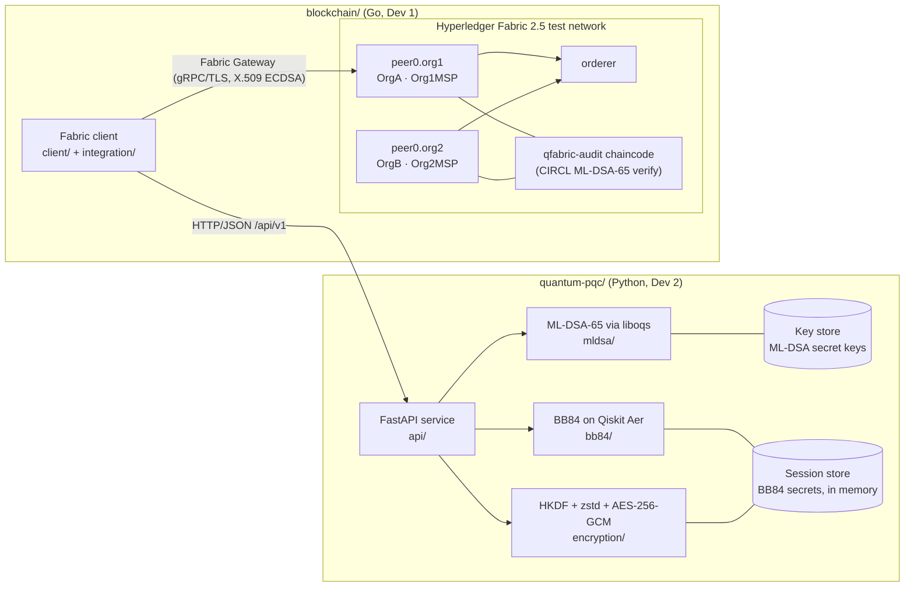
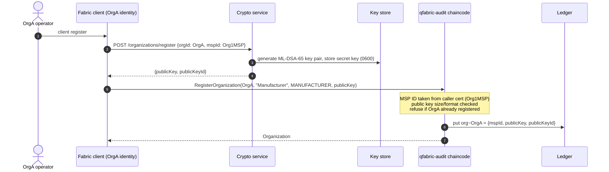
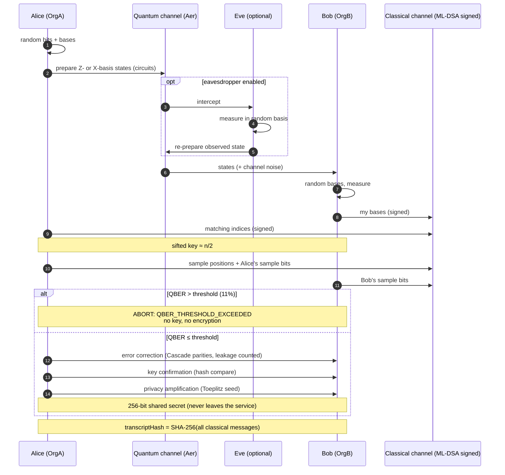
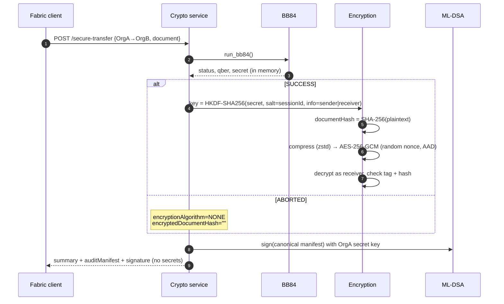
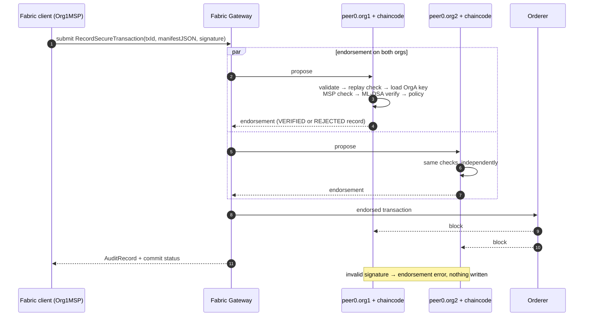

# QFabric Architecture

## 1. Components



| Layer | Responsibility | Trust |
|---|---|---|
| Crypto service | Runs BB84, signs manifests, encrypts documents | Trusted to keep secrets. **Not** trusted by the ledger for verdicts |
| Fabric client | Moves signed manifests from the service to the ledger | Untrusted courier (cannot forge ML-DSA signatures) |
| Chaincode | Verifies ML-DSA signatures and applies the security policy | Trust anchor for audit records (endorsed by both orgs) |
| Ledger | Append-only, hash-chained audit history | Tamper-evident |

## 2. Two authentication layers

| | Fabric MSP | Application ML-DSA |
|---|---|---|
| What it proves | A Fabric member (X.509 cert) submitted or endorsed a transaction | The sender organization authored this exact audit manifest |
| Algorithm | ECDSA P-256 (classical) | ML-DSA-65 (FIPS 204, post-quantum) |
| Verified by | Peers and orderer (Fabric core) | `qfabric-audit` chaincode on every endorsing peer |
| Key source | Fabric CA / cryptogen | Crypto service key store. Public key anchored on the ledger |
| Quantum threat | Vulnerable to Shor | Designed to resist |

The chaincode also binds the two layers: the submitter's MSP must equal the sender org's registered MSP.

## 3. Sequence diagrams

### 3.1 Organization authentication (key registration)



### 3.2 BB84 key establishment



### 3.3 Secure document exchange



### 3.4 Blockchain audit recording



## 4. Data on the ledger

| Stored | Never stored |
|---|---|
| Org ID, MSP ID, ML-DSA **public** key + fingerprint | ML-DSA secret keys |
| Document SHA-256, ciphertext SHA-256, transcript SHA-256 | Plaintext documents, ciphertext |
| QBER, threshold, key lengths, BB84 status | BB84 shared secret, AES key |
| ML-DSA signature, security status, rejection reasons | |
| Fabric tx ID, submitter MSP, tx timestamp | |

Key layout (composite keys): `org~<orgId>`, `tx~<transactionId>`, `session~<sessionId>` (replay guard).

## 5. Deployment views

| Mode | Crypto service | Fabric |
|---|---|---|
| Dev 2 local | `uvicorn api.main:app --reload` in `quantum-pqc/.venv` | not needed |
| Dev 1 local | `docker compose up crypto`, or none (use samples + test vector) | `blockchain/scripts/start-network.sh` |
| Demo | `docker compose up crypto` | test network, both orgs on one host |

## 6. Deviations from the initial layout

| Change | Reason |
|---|---|
| `blockchain/go.mod` at module root instead of `blockchain/client/go.mod` | `client/`, `integration/` and `tests/` share one Go module and can import each other. The chaincode keeps its own `go.mod` (nested module) because Fabric packages it standalone and `go mod vendor` refuses to run in workspace mode |
| `blockchain/network/{docker-compose,config,organizations,channel-artifacts}` not pre-created | Phase 2 uses the official `fabric-samples/test-network`, downloaded by `start-network.sh` into `blockchain/network/fabric-samples/` (git-ignored). Custom network config moves into `blockchain/network/` only if the test network becomes limiting |
| Added `blockchain/scripts/common.sh` | Shared variables and pinned versions for the four network scripts |
| Added `quantum-pqc/mldsa/manifest.py` | Canonical manifest serialization, the core of the integration contract |
| Added `GET /api/v1/organizations/{orgId}` | Lets the client fetch an existing org's public key (register is not idempotent) |
| Added `quantum-pqc/Dockerfile`, `pytest.ini` | Reproducible liboqs build. Test import paths |
| Added `integration/test_vectors/` | Cross-language ML-DSA-65 interop gate |
| Added `quantum-pqc/third_party/qiskit` (vendored Qiskit 2.6.1 source) | Qiskit is built from source in the repo, so the exact quantum SDK code is visible and pinned. See `quantum-pqc/third_party/README.md` |
| `benchmarks/cryptography/` and `benchmarks/blockchain/` not pre-created | Empty directories are not tracked by git. They are created with the first benchmark script (see `docs/BENCHMARKING.md`) |

## 7. Where the cryptography lives (file map)

### Post-quantum cryptography: ML-DSA-65 (FIPS 204)

| File | Role |
|---|---|
| `quantum-pqc/mldsa/__init__.py` | Algorithm constants (1952 B public key, 3309 B signature). Locates the in-repo liboqs build (`quantum-pqc/.oqs`) |
| `quantum-pqc/mldsa/keygen.py` | `generate_keypair()` via liboqs. `public_key_id()` = SHA-256 fingerprint |
| `quantum-pqc/mldsa/signing.py` | `sign()`: pure ML-DSA-65, empty context |
| `quantum-pqc/mldsa/verification.py` | `verify()`: returns False on any malformed input |
| `quantum-pqc/mldsa/identity.py` | `KeyStore`: per-org key pairs, secret key file mode 0600, `sign_as()` without exposing keys |
| `quantum-pqc/mldsa/manifest.py` | `canonical_manifest()`: the exact bytes signed for the ledger |
| `quantum-pqc/api/services.py` | Signs the BB84 transcript as **both** orgs and the audit manifest as the sender. Verifies before accepting |
| `blockchain/chaincode/qfabric-audit/audit.go` | `verifyMLDSA65()` with Cloudflare CIRCL: **on-chain verification** on every endorsing peer |
| `blockchain/chaincode/qfabric-audit/transaction.go` | `CanonicalBytes()`: the Go twin of `canonical_manifest()` |
| `blockchain/chaincode/qfabric-audit/organization.go` | Anchors each org's ML-DSA public key on the ledger, bound to its Fabric MSP |
| `integration/test_vectors/mldsa65_audit_manifest.json` | Cross-language vector: a CIRCL signature that liboqs must verify |

### Quantum cryptography: BB84 on Qiskit (vendored source in `quantum-pqc/third_party/qiskit`)

| File | Role |
|---|---|
| `quantum-pqc/bb84/alice.py` | Random bits and bases. Builds `QuantumCircuit`s: X for bit 1, H for the X basis |
| `quantum-pqc/bb84/eavesdropper.py` | Intercept-resend Eve: real mid-circuit measurement in a random basis |
| `quantum-pqc/bb84/quantum_channel.py` | Pauli-noise channel (`qiskit_aer.noise.pauli_error`), `AerSimulator(method="stabilizer")`, register decoding |
| `quantum-pqc/bb84/bob.py` | Random bases, measurement, runs the circuits on Aer |
| `quantum-pqc/bb84/basis_reconciliation.py` | Sifting, sample selection, QBER |
| `quantum-pqc/bb84/error_correction.py` | Cascade with backtracking, leakage counting |
| `quantum-pqc/bb84/privacy_amplification.py` | Binary entropy, secure length, Toeplitz hashing |
| `quantum-pqc/bb84/protocol.py` | `run_bb84()`: orchestration, abort rules, canonical transcript |

### Symmetric layer driven by the BB84 key

| File | Role |
|---|---|
| `quantum-pqc/encryption/key_derivation.py` | HKDF-SHA-256(BB84 secret, salt = session, info = direction), AAD |
| `quantum-pqc/encryption/compression.py` | zstd / gzip with a decompression-bomb limit |
| `quantum-pqc/encryption/encryption.py` | AES-256-GCM encryption, `documentHash`, `encryptedDocumentHash` |
| `quantum-pqc/encryption/decryption.py` | AES-256-GCM decryption. `TamperDetectedError` on tag failure |

### How a secure transfer flows through these files

```
blockchain/client/main.go  (transfer)
  └─ blockchain/integration/crypto_client.go ── POST /api/v1/secure-transfer ──► quantum-pqc/api/routes.py
                                                                                 └─ api/services.py: secure_transfer()
     1. bb84/protocol.py run_bb84()
          alice.py → eavesdropper.py → quantum_channel.py → bob.py      (Qiskit circuits on Aer)
          basis_reconciliation.py → error_correction.py → privacy_amplification.py
     2. mldsa/identity.py sign_as(sender) + sign_as(receiver) over the transcript   (ML-DSA-65)
     3. encryption/key_derivation.py → compression.py → encryption.py → decryption.py (delivery check)
     4. mldsa/manifest.py canonical_manifest() → identity.py sign_as(sender)          (ML-DSA-65)
  ◄── auditManifest + signature
blockchain/client/transaction.go ── RecordSecureTransaction ──► Fabric Gateway ──► both peers:
     chaincode transaction.go CanonicalBytes() → audit.go verifyMLDSA65() (CIRCL)
     → PolicyViolations() → ledger: VERIFIED / REJECTED
```
